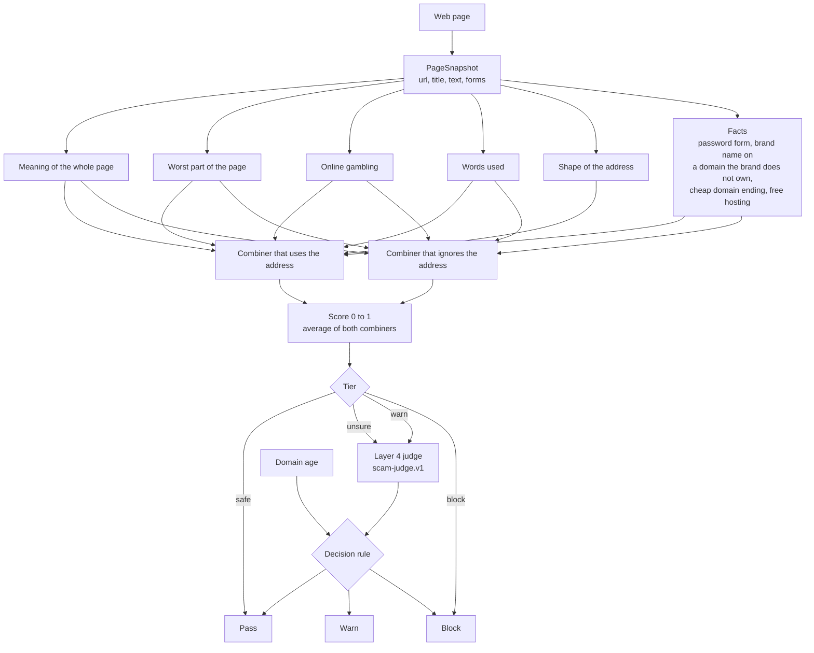

# shoo-layer3-lab

Shoo blocks scam sites on iPhone. Its server has a step called layer 3 that reads a page and decides how risky it is.
Today that step is a list of hand-written rules.

This repo is an experiment. It replaces those rules with a trained model, adds a new prompt for the AI check that
comes after it (layer 4), and measures both against what Shoo runs today.

Nothing here ships. The Shoo repo is only read: its parser and rules are imported, never edited.

## Results

Two names are used below:

- **Shipped** is what the Shoo repo runs today: layers 1-2 on the phone, the layer 3 rules, and the layer 4 prompt
  `reality-check.v4`.
- **Rebuilt** is this lab: the trained layer 3 and the layer 4 prompt `scam-judge.v1`.

A page counts as caught when the pipeline warns about it or blocks it.

### Live pages

500 real URLs from `site/urls-500.csv`, opened on 13 Nov 2026. None of these sites was used for training.
397 pages were counted. The other 103 were left out: 75 sent the browser to a different site, 11 showed a
"prove you are human" page, and 17 did not open.

| Pipeline | Accuracy | Scam caught | Scam passed as safe | Legit pages flagged |
|---|---|---|---|---|
| Shipped | 64.7% | 23.1% (40 of 173) | 76.9% | 3.1% (7 of 224) |
| Rebuilt, strict rule | 88.4% | 96.0% (166 of 173) | 4.0% | 17.4% (39 of 224) |
| Rebuilt, balanced rule | 94.5% | 94.8% (164 of 173) | 5.2% | 5.8% (13 of 224) |

### Saved pages

2,402 saved pages from sites that were not used for training: 828 scam and 1,574 legit. These pages are old, so
neither pipeline could use the live blocklist or the age of the domain. The balanced rule needs the domain age, so it
is not in this table.

| Pipeline | Accuracy | Scam caught | Scam passed as safe | Legit pages flagged |
|---|---|---|---|---|
| Shipped | 65.9% | 3.4% (28 of 828) | 96.6% | 1.1% (18 of 1,574) |
| Rebuilt, layer 3 alone | 92.0% | 82.1% (680 of 828) | 17.9% | 2.8% (44 of 1,574) |
| Rebuilt, strict rule | 88.3% | 96.1% (796 of 828) | 3.9% | 15.9% (250 of 1,574) |
| Rebuilt, judge rule | 92.3% | 86.7% (718 of 828) | 13.3% | 4.7% (74 of 1,574) |

### How much to trust these numbers

- The balanced rule looks better than it is. Its domain age limits were picked on the same 500 URLs it is scored on.
  It needs a new URL list to confirm.
- A scam label on a live URL means someone reported it to a public phishing feed that day. Some of those pages had
  already been replaced when we opened them.
- Some saved pages are labelled scam by mistake, for example the real site of a well-known shop. That pulls every row
  down a little.
- The rebuilt pipeline ran without the phone layers 1-2. The shipped one ran with them.
- The rebuilt pipeline asks the AI more often: for 142 of the 397 live pages (36%). The shipped one asks only when
  the score is between 30 and 79.

## How it works



Step by step:

1. **Input.** The model sees only what the Shoo extension already sends: the address, the title, the page text and
   the form fields. It never sees the raw HTML.
2. **Text to numbers.** The text is cut into at most four pieces of 1,200 characters. A public model called
   `BAAI/bge-m3` turns each piece into a list of 1,024 numbers that stands for its meaning. We do not train that
   model.
3. **Five small models.** Each one gives a score from 0 to 1:
   - the meaning of the whole page,
   - the most suspicious piece of the page,
   - online gambling wording (also trained on Indonesian gambling captions),
   - which words and letter patterns appear in the text,
   - letter patterns in the address.
4. **Facts.** Things that can be checked directly: a password field, a brand name on a domain the brand does not own,
   a cheap domain ending, free hosting, a raw IP address. The brand list comes from Shoo's own `brands.json`.
5. **Two combiners.** Both take the five scores and the facts and produce one score. One of them ignores the address.
   That matters for hacked school and government sites: the address looks trustworthy, the content is gambling.
   The final score is the average of the two.
6. **Tiers.** The score puts the page in one of four tiers: safe, unsure, warn or block. Indonesian pages and other
   pages have their own limits. The limits are set so that only a small share of legit pages lands in each tier:
   0.5% in block, 2% in warn, 15% in unsure. Official brand domains are always safe.
7. **Layer 4 judge.** For unsure and warn pages, an LLM reads the page and answers scam, legit or unsure, with a
   quote from the page as evidence.
8. **Decision rule.** This turns the tier and the judge's answer into what the user sees:
   - **strict**: every unsure page gets a soft warning. Fewest scams get through, most legit pages get flagged.
   - **judge**: an unsure page passes when the judge says legit.
   - **balanced**: the judge's "legit" only counts when the domain is old enough (1 year for unsure, 3 years for
     warn) and the address has no brand name, free hosting or raw IP in it. A page on a domain younger than 180 days
     that uses a brand name is always sent to the judge, even if layer 3 called it safe.

For comparison, the shipped pipeline adds up points from hand-written rules. Below 30 points nothing is shown. From
30 to 79 it asks layer 4. At 80 or more it blocks.

### Size

| Part | Size |
|---|---|
| The models we trained (five small models, two combiners) | 18 MB |
| `BAAI/bge-m3`, used as it is | about 2.3 GB on disk, 1.1 GB in memory at half precision |

Retraining with new data only touches the 18 MB part and takes minutes.

## What we learned

- The shipped layer 4 prompt only judges whether a form asks for too much. We asked it about 373 scam pages and it
  answered "reasonable" for 353 of them. It has nothing to say about scams without a form: fake shops, gambling,
  investment schemes, giveaways.
- The new judge prompt was written once and not adjusted after looking at test results. On saved pages it raised
  blocked scams from 51.1% to 63.5% and called 12 of 245 legit pages scam.
- The judge called 161 scam-labelled saved pages legit. 36 of those are on the list of the one million most visited
  sites, so the label is probably wrong. 11 were dead or placeholder pages. Most of the rest are shop pages that read
  like any real shop.
- A copy of a real shop cannot be caught from its text. It needs the domain age and the blocklist.
- Many reported phishing domains send visitors they do not want to Yahoo, Bing or Google. 75 of the 500 live URLs did
  this. What loads is the real search engine, so neither pipeline can flag it.
- Indonesian results on saved pages: of 38 real Indonesian phishing pages and 23 online gambling pages, the strict
  rule let none through.
- Bare login pages with very little text are the main source of wrong flags. They look like phishing pages.
- Shoo's eval corpus has 10 hand-written legit pages built to be tricky (a real identity check, a news article about
  scams, a checkout with card fields). 6 or 7 of them still get flagged. The 29 real legit pages in that corpus: none.
- The judge cost, for 637 calls on saved pages: 1.11M tokens in, 0.33M out, 1.5 seconds median, 2.6 seconds at the
  95th percentile.

## Known limits

- It runs in Python on a Mac. Shoo's server is a Cloudflare Worker, which cannot hold a 2.3 GB model. A real
  deployment would call an embedding service for `bge-m3` and ship only the 18 MB part, exported to plain weight
  tables. That export is not written yet.
- Hacked sites often show the scam only to search engines. A normal visit sees the clean site.
- The compare site reads pages with headless Chromium from this Mac. Some sites block it, and a page can look
  different in Safari on a phone.
- There is a bug in the Shoo repo's eval tool, not in this lab: the email mask in `ai/eval/tools/patterns.mjs` line 14
  takes minutes on long text without an `@`. Two pages that trigger it are `data/phish/00590.html.gz` and
  `data/phish/02224.html.gz`. This lab cuts unfinished `<script>` and `<style>` tails and gives each page 4 seconds.

## Data

Not in git. 15,876 pages in total, split by site so that no site is in both training and test: 10,995 to train,
2,431 to set the tier limits, 2,402 to test.

| Source | Label | Pages |
|---|---|---|
| `kirco567/ScamWeb-Dataset` (CC BY 4.0) | scam and legit | 3,041 and 2,227 |
| `nyuuzyou/phishing-snapshots` (CC0), takedown pages removed | scam | 3,489 |
| Indonesian pages from the same phishing set | scam | 165 |
| Indonesian online gambling pages found by search | scam | 90 |
| Popular sites: home page, a login or checkout page, one more page | legit | 1,714 |
| Small, little-known sites | legit | 2,500 |
| Indonesian `.id` sites and 173 hand-picked Indonesian sites | legit | 1,610 |
| Hard legit pages: logins, checkouts, articles about scams | legit | 992 |
| `0xRafie/indonesian-gambling-multimodal-dataset` captions | training only | 4,892 |
| Shoo's eval corpus (47 scam, 39 legit) | test only | 86 |

Two cleaning steps:

- Training pages with a label that is clearly wrong are dropped: pages labelled scam that every model, trained
  without them, calls legit. Test pages are never dropped.
- One source was thrown out. Reported Indonesian phishing URLs, fetched today, now show unrelated pages, so their
  labels are wrong.

Scam pages are hostile. The training data is saved HTML that is only parsed as text.

## Run the experiment

```bash
A=~/epel/Final-CH7/ai
node src/build_snapshots.mjs $A data/scamweb out/pages.jsonl                         # ScamWeb pages + what the current rules say
node src/build_snapshots.mjs $A --corpus out/corpus.jsonl                            # Shoo's eval corpus
python3 -I src/fetch_pages.py sites data/legit_top data/lists/sites_top.txt          # legit pages: home + login/checkout + one more
python3 -I src/fetch_pages.py urls data/judol data/lists/judol_urls.txt              # reported scam URLs, plain download only
uv run --no-project --with duckdb python -I src/sample_phish.py data/phish 6         # real phishing pages
node src/build_snapshots.mjs $A --dir out/src_phish.jsonl data/phish 1 phish -       # one per source: <dir> <label> <prefix> <language|->
python3 -I src/assemble.py out                                                       # clean and merge sources into out/extra.jsonl
uv run python src/embed.py out/pages.jsonl out/emb                                   # text to numbers
uv run python src/embed.py out/extra.jsonl out/extra_emb
uv run python src/embed.py out/corpus.jsonl out/corpus_emb
uv run python src/train_eval.py out --refit                                          # train everything (about 25 min)
node src/layer4_run.mjs $A out                                                       # shipped pipeline on the test pages
node src/layer4_v5.mjs $A out                                                        # new judge prompt on unsure and warn pages
python3 -I src/pipeline_eval.py out                                                  # the comparison tables
cd src && uv run python analyze.py --id scam_18544                                   # one page, both systems, with evidence
```

## Compare site

A local web page. Paste URLs, and both pipelines answer side by side with a screenshot and the evidence from each
layer. You mark each page as scam or legit, and the site shows who missed and who flagged a legit page.

```bash
cd site && npm install && cd ..
uv run python site/server.py     # then open http://127.0.0.1:8799
```

- `site/reader.mjs` opens each URL once in headless Chromium (phone size, no saved profile), takes a screenshot and
  runs the shipped pipeline from the Shoo repo, with the live domain age.
- `site/server.py` runs the rebuilt layer 3 and the judge prompt. It needs `out/layer3_base.joblib` and
  `out/layer3_meta.joblib`, which `src/train_eval.py` writes. It only listens on this machine.
- Both read the LLM settings from `~/epel/Final-CH7/ai/.dev.vars` while running. No key is stored in this repo.
- `site/urls-500.csv` has 500 labelled URLs: reported phishing from public feeds, online gambling, and legit sites.
  The scam URLs are live. Do not open them in your normal browser.
- Results can be exported as CSV or JSON.
- `site/compare.html` is an older static mock. `site/build.py` builds it from `template.html` and the sample files.
